# Evaluación Parcial N° 2 – AUY1102 Ciclo de Vida del Software I

**Desarrollo de Pruebas Unitarias y Análisis de Seguridad II**

| Dato | Valor |
|---|---|
| Organización GitHub | `grupo-4duoc` |
| Repositorio | https://github.com/grupo-4duoc/AUY1102-Pipeline |
| Repositorio base (docente) | https://github.com/Fundacion-Instituto-Profesional-Duoc-UC/AUY1102-Pipeline |
| Ramas de trabajo | `feature/parcial2-simon` (Simón) · `feature/pruebas-unitarias` (Abraham, integrada con `git merge`) |
| Integrantes | Abraham Ravelo · Simón Lagos |
| Fecha | 06-11-2026 |

> Las imágenes están en la carpeta `img/` del repositorio.

---

## Índice

1. [Contexto](#1-contexto)
   - 1.1 [Conceptos clave de calidad de software (IE3.1.1)](#11-conceptos-clave-de-calidad-de-software-ie311)
   - 1.2 [Herramientas de aseguramiento de calidad (IE3.2.1)](#12-herramientas-de-aseguramiento-de-calidad-ie321)
2. [Preparación del entorno](#2-preparación-del-entorno)
3. [Parte 1 – Pruebas unitarias y cobertura](#3-parte-1--pruebas-unitarias-y-cobertura)
4. [Parte 2 – Análisis de seguridad y código estático](#4-parte-2--análisis-de-seguridad-y-código-estático)
   - 4.1 [npm audit](#41-npm-audit)
   - 4.2 [Snyk](#42-snyk)
   - 4.3 [SonarCloud](#43-sonarcloud)
   - 4.4 [GitHub Advanced Security](#44-github-advanced-security)
   - 4.5 [Remediación](#45-remediación)
   - 4.6 [Integración a `master` y verificación de las remediaciones](#46-integración-a-master-y-verificación-de-las-remediaciones)
5. [Hallazgos de seguridad detectados en el código](#5-hallazgos-de-seguridad-detectados-en-el-código)
6. [Conclusiones](#6-conclusiones)
7. [Distribución del trabajo](#7-distribución-del-trabajo)

---

## 1. Contexto

La empresa *Integration Solutions* busca automatizar su ciclo de desarrollo migrando a GitHub e
incorporando revisiones de **calidad** (pruebas unitarias, cobertura y análisis estático) y de
**seguridad** (vulnerabilidades en dependencias, código inseguro y secretos expuestos).

El proyecto es una librería **TypeScript** de *Value Objects* (`StringValueObject`,
`NumberValueObject`, `DateValueObject`, `EnumValueObject`) probada con **Jest**. La carpeta
`src/quality/` contiene código inseguro intencional que sirve para validar las herramientas de análisis.

**¿Por qué importa en el ciclo de vida?** Mientras antes se detecta un error o una vulnerabilidad
(*shift-left*), más barato es corregirlo. Un bug detectado por una prueba unitaria en un Pull Request
cuesta minutos; el mismo bug en producción puede costar días y generar incidentes de seguridad.

### 1.1 Conceptos clave de calidad de software (IE3.1.1)

A continuación explicamos los conceptos solicitados en la rúbrica y cómo aportan a la calidad del software:

* **Pruebas unitarias:** revisan que una función, método o clase pequeña funcione bien de forma aislada,
  sin depender de bases de datos ni servicios externos. Ayudan a encontrar errores de lógica rápido,
  mientras uno programa. *Ejemplo en este proyecto:* las pruebas de `DateValueObject` (sección 3.4).
* **Calidad de código estático:** revisar el código **sin ejecutarlo** (con linters como ESLint o
  herramientas como SonarCloud). Sirve para detectar malas prácticas, código duplicado y posibles fallas
  antes de compilar. *Ejemplo:* SonarCloud (sección 4.3).
* **Calidad de código dinámico:** evaluar el software **mientras se ejecuta** (por ejemplo, corriendo
  las pruebas con Jest). Permite ver el comportamiento real, si fallan funciones o si hay problemas de
  rendimiento en tiempo de ejecución. *Ejemplo:* `npm run test:coverage` (sección 3).
* **Análisis de seguridad y vulnerabilidades:** buscar fallas de seguridad en el código propio (como
  inyecciones SQL o XSS) o en las librerías que usamos (dependencias vulnerables). Sirve para que nadie
  pueda atacar o botar el sistema. *Ejemplo:* npm audit, Snyk y GitHub Advanced Security (sección 4).
* **Pruebas integradas:** prueban cómo interactúan dos o más partes del sistema entre sí (por ejemplo,
  que la API se conecte bien con la base de datos). Aseguran que las partes que funcionan solas también
  funcionen juntas.
* **Pruebas de estrés:** exigen al sistema al máximo, con mucho tráfico o muchos datos, para ver en qué
  punto falla y cómo se recupera.
* **Pruebas de regresión:** son las pruebas que se vuelven a correr después de un cambio o arreglo para
  confirmar que lo nuevo no rompió lo que ya funcionaba. *Ejemplo:* volver a correr las pruebas después
  de actualizar `chokidar` (sección 4.5) y después de integrar la rama de Abraham (sección 3.6).

### 1.2 Herramientas de aseguramiento de calidad (IE3.2.1)

| Herramienta | Para qué sirve | En qué etapa del ciclo de vida se usa | Beneficio principal |
|---|---|---|---|
| **Jest** | Framework para ejecutar pruebas unitarias y medir cobertura. | Desarrollo (mientras se programa y antes de subir cambios). | Detecta fallas de lógica al instante, antes de pasar a producción. |
| **SonarCloud** | Plataforma de análisis estático continuo de calidad y seguridad. | Integración continua (en cada *push* o *Pull Request*). | Muestra la deuda técnica, los *code smells* y si el código pasa el *Quality Gate*. |
| **Snyk** | Escáner de seguridad para dependencias, contenedores y código fuente. | Desarrollo y CI/CD. | Avisa si usamos librerías viejas con vulnerabilidades y recomienda cómo arreglarlas. |
| **npm audit** | Comando nativo de npm para revisar vulnerabilidades de paquetes. | Instalación y empaquetado de dependencias. | Rápido y directo en la terminal; permite parchar paquetes con `npm audit fix`. |
| **GitHub Advanced Security** | Herramientas de seguridad dentro de GitHub (Secret Scanning y Dependabot). | Repositorio y control de versiones. | Avisa (y con *push protection* bloquea) si alguien sube contraseñas o tokens al repositorio. |

---

## 2. Preparación del entorno

### 2.1 Herramientas

| Herramienta | Versión | Uso |
|---|---|---|
| Git | 2.54 | Control de versiones |
| Node.js | v26.13.0 (LTS) | Ejecutar el proyecto y las pruebas |
| npm | 11.20.0 | Dependencias, scripts y `npm audit` |
| Visual Studio Code | – | Editor y terminal |

Node.js no estaba instalado, así que se instaló con el gestor de paquetes de Windows:

```powershell
winget install OpenJS.NodeJS.LTS --accept-source-agreements --accept-package-agreements
node --version    # v26.13.0
npm --version     # 11.20.0
```

### 2.2 Repositorio (fork) y rama de trabajo

1. Se creó un **fork** del repositorio indicado por el docente
   (`Fundacion-Instituto-Profesional-Duoc-UC/AUY1102-Pipeline`) dentro de la organización `grupo-4duoc`.
2. Se clonó localmente y se creó una rama propia. Como el trabajo es en pareja, **no se trabaja sobre `master`**:

```bash
git clone https://github.com/grupo-4duoc/AUY1102-Pipeline.git
cd AUY1102-Pipeline
git checkout -b feature/parcial2-simon
npm install
```

`npm install` instaló **1599 paquetes** y advirtió **82 vulnerabilidades**, que se analizan en la sección 4.1.

3. En paralelo, Abraham trabajó las pruebas unitarias en la rama `feature/pruebas-unitarias` (PR #4).
   Su trabajo se integró en `feature/parcial2-simon` con un **merge**, sin copiar archivos a mano, para que
   su commit quede registrado con su autoría:

```bash
git fetch origin
git merge --no-ff origin/feature/pruebas-unitarias
# Conflicto en package.json: se conservaron test:coverage (Simón) y test:report (Abraham)
```

---

## 3. Parte 1 – Pruebas unitarias y cobertura

> Esta parte se trabajó en dos ramas: **Simón Lagos** creó el script `run-tests.sh` (rama
> `feature/parcial2-simon`) y **Abraham Ravelo** corrigió el bug de `DateValueObject`, creó sus pruebas
> y el script `reporte-pruebas.js` (rama `feature/pruebas-unitarias`, PR #4). Ambas ramas se integraron
> con `git merge`, conservando la autoría de cada commit.

### 3.1 Conceptos de cobertura

> Los conceptos generales (prueba unitaria, regresión, etc.) están en la sección [1.1](#11-conceptos-clave-de-calidad-de-software-ie311).

- **Cobertura de código:** porcentaje del código que se ejecuta durante las pruebas. Se mide en
  *sentencias*, *líneas*, *funciones* y *ramas* (cada camino de un `if/else`).
- Una cobertura baja **no significa que el código falle**, sino que hay partes **sin verificar**, donde
  un error puede pasar desapercibido. Eso fue justo lo que pasó con `DateValueObject` (sección 3.4).

### 3.2 Script `scripts/run-tests.sh` (Simón Lagos)

Se creó el script [`scripts/run-tests.sh`](scripts/run-tests.sh) y se conectó al comando
`npm run test:coverage` en `package.json`:

```json
"test:coverage": "bash scripts/run-tests.sh"
```

| Etapa | Qué hace |
|---|---|
| 1. Ejecutar pruebas | Ejecuta `jest --coverage` y genera reportes `json`, `json-summary` y `lcov` (`coverage/lcov.info`, que puede usar SonarCloud). |
| 2. Pruebas que fallan | Lista cada prueba fallida con su archivo y su mensaje de error. |
| 3. Código no cubierto | Por cada archivo muestra las **líneas**, **funciones** y **ramas** que ninguna prueba ejecutó. |
| 4. Resumen | Tabla de % de cobertura por archivo y total. |
| Salida | Código `0` si todo pasa y `1` si alguna prueba falla (útil para CI). |

Además se agregó `coverage` al `.gitignore`, porque los reportes son archivos generados.

### 3.3 Ejecución inicial (código original)

```bash
npm run test:coverage
```

```text
==================== 2. PRUEBAS QUE FALLAN ====================
Suites : 10 OK / 0 con fallos / 10 total
Pruebas: 18 OK / 0 fallidas / 18 total

✔ Todas las pruebas pasaron.

==================== 3. CÓDIGO NO CUBIERTO POR PRUEBAS ====================
• src/value-object/primitives/date-value-object.ts
    Líneas sin cubrir   : 3, 7-9, 13-14, 19, 23-25, 29-30, 34-35
    Ramas (if/else) sin cubrir: 3
• src/value-object/primitives/enum-value-object.ts
    Líneas sin cubrir   : 11
    Ramas (if/else) sin cubrir: 1
  (... más los archivos de src/quality/ e index.ts)

==================== RESUMEN DE COBERTURA ====================
  Sentencias  :  43.28 %  (29/67)
  Ramas       :     60 %  (6/10)
  Funciones   :  56.66 %  (17/30)
  Líneas      :  43.28 %  (29/67)
```

Las 18 pruebas pasaban, pero **`DateValueObject` tenía solo 6,66 % de cobertura**: no existía ninguna
prueba para esa clase.

### 3.4 Bug en `DateValueObject` y pruebas nuevas (Abraham Ravelo)

Al revisar [`src/value-object/primitives/date-value-object.ts`](src/value-object/primitives/date-value-object.ts),
Abraham encontró que la validación de la fecha (línea 13) tenía la **condición invertida**:

```diff
   private checkDateIsValue(date: string): void {
-    if (!Number.isNaN(new Date(date).getTime())) {
+    if (Number.isNaN(new Date(date).getTime())) {
       this.throwErrorForInvalidDate(date);
     }
   }
```

- **Antes:** con el `!`, el error se lanzaba cuando la fecha **era válida** y se aceptaban fechas inválidas.
  En la práctica, la clase **no se podía usar** con ninguna fecha correcta.
- **Después:** solo se lanza error cuando la fecha **no es válida**, que es lo que corresponde.

Las 18 pruebas originales **no detectaron este bug** porque ninguna probaba `DateValueObject`. Es el
ejemplo perfecto de por qué importa la cobertura.

Para cubrir la clase creó un *mock* y 5 pruebas nuevas:

- [`test/value-object/primitives/DateValueObject/__mocks__/BirthDate.ts`](test/value-object/primitives/DateValueObject/__mocks__/BirthDate.ts):
  clase concreta `BirthDate` que extiende `DateValueObject` (que es abstracta).
- [`test/value-object/primitives/DateValueObject/dateValueObject.test.ts`](test/value-object/primitives/DateValueObject/dateValueObject.test.ts):

| Prueba | Qué verifica |
|---|---|
| debe crearse correctamente con una fecha valida | Una fecha válida se acepta y se guarda en formato ISO |
| debe lanzar error cuando se pasa una fecha invalida | `'fecha-falsa'` lanza `Fecha invalida: fecha-falsa` (la prueba del bug) |
| debe comparar si una fecha es anterior a otra | `isBeforeThisDate()` |
| debe comparar si una fecha es posterior a otra | `isAfterThisDate()` |
| debe validar si una fecha esta entre dos fechas | `isBetweenTheDates()` |

### 3.5 Script `scripts/reporte-pruebas.js` (Abraham Ravelo)

Abraham creó un segundo script, en Node.js, conectado al comando `npm run test:report`:

```json
"test:report": "node scripts/reporte-pruebas.js"
```

Ejecuta `jest --coverage`, avisa si alguna prueba falló y luego lee `coverage/coverage-final.json` para
mostrar una tabla con el **% de cobertura y las líneas sin cobertura de cada archivo**, más una lista de
los componentes que faltan por probar:

```text
=============================================================================
                 RESUMEN DE COBERTURA Y LINEAS SIN PRUEBAS
=============================================================================
Archivo                                      | Cobertura    | Lineas sin cobertura
-----------------------------------------------------------------------------
src/value-object/primitives/date-value-object.ts| 100.0%       | Ninguna (100%)
src/value-object/primitives/enum-value-object.ts| 83.3%        | 11
...
-----------------------------------------------------------------------------
TOTAL PROYECTO: 64.2% de cobertura global
```

**Los dos scripts se mantienen** porque se complementan:

| | `npm run test:coverage` (Simón) | `npm run test:report` (Abraham) |
|---|---|---|
| Lenguaje | Bash + Node.js | Node.js |
| Pruebas que fallan | Lista cada prueba con su mensaje de error | Aviso general |
| Código no cubierto | Líneas, funciones y ramas | Líneas |
| Genera `lcov.info` (SonarCloud) | Sí | No |
| Código de salida para CI | `1` si falla una prueba | Siempre `0` |

### 3.6 Resultados después de integrar las pruebas de Abraham

```bash
git merge origin/feature/pruebas-unitarias
npm run test:coverage
```

```text
==================== 2. PRUEBAS QUE FALLAN ====================
Suites : 11 OK / 0 con fallos / 11 total
Pruebas: 23 OK / 0 fallidas / 23 total

✔ Todas las pruebas pasaron.

==================== RESUMEN DE COBERTURA ====================
  Sentencias  :  64.17 %  (43/67)
  Ramas       :     90 %  (9/10)
  Funciones   :     80 %  (24/30)
  Líneas      :  64.17 %  (43/67)
  Resultado    : ÉXITO ✔
```

**Pruebas:**

| | Antes | Después |
|---|---:|---:|
| Suites | 10 | 11 |
| Pruebas | 18 | **23** |
| Fallidas | 0 | 0 |

**Cobertura por archivo (% de líneas):**

| Archivo | Antes | Después |
|---|---:|---:|
| src/index.ts | 62.5 | 62.5 |
| src/quality/errores-object.ts | 0 | 0 |
| src/quality/insecure-1-object.ts | 0 | 0 |
| src/quality/insecure-2-object.ts | 0 | 0 |
| src/value-object/primitives/date-value-object.ts | **6.66** | **100** |
| src/value-object/primitives/enum-value-object.ts | 83.33 | 83.33 |
| src/value-object/primitives/number-value-object.ts | 100 | 100 |
| src/value-object/primitives/string-value-object.ts | 100 | 100 |

**Cobertura total:**

| Métrica | Antes | Después |
|---|---:|---:|
| Sentencias | 43.28 % | **64.17 %** |
| Ramas | 60 % | **90 %** |
| Funciones | 56.66 % | **80 %** |
| Líneas | 43.28 % | **64.17 %** |

**Análisis:**
- `DateValueObject` pasó de **6,66 % a 100 %** y se corrigió un bug que dejaba la clase inutilizable.
- La cobertura total subió **casi 21 puntos** (de 43 % a 64 %).
- **Pendiente:** en `EnumValueObject` falta probar el caso de **valor inválido** (línea 11, la rama del `throw`).
- `src/quality/*.ts` es código de ejemplo inseguro, sin pruebas; es lo que mantiene la cobertura total bajo 100 %.

> **Observación:** durante la ejecución aparece el aviso *"Cannot log after tests are done"*. Se debe a
> que `src/index.ts` ejecuta `fetchData()` al ser importado y llama a `api.example.com`. Es un problema
> de diseño que además expone credenciales (ver sección 5).

---

## 4. Parte 2 – Análisis de seguridad y código estático

### 4.1 npm audit

**Qué es:** comando nativo de npm que compara las dependencias instaladas (directas y transitivas)
con la base de datos de vulnerabilidades conocidas (GitHub Advisory Database / CVE).

**Ejecución:**

```bash
npm audit > docs/npm-audit-report.txt                  # reporte completo
npm audit --json > docs/npm-audit-report.json          # reporte completo en JSON
npm audit --omit=dev > docs/npm-audit-prod-report.txt  # solo dependencias de producción
```

Reportes: [`docs/npm-audit-report.txt`](docs/npm-audit-report.txt) ·
[`docs/npm-audit-report.json`](docs/npm-audit-report.json) ·
[`docs/npm-audit-prod-report.txt`](docs/npm-audit-prod-report.txt)

```text
82 vulnerabilities (11 low, 20 moderate, 49 high, 2 critical)

To address issues that do not require attention, run:
  npm audit fix
```

**Resultados:**

| Severidad | Todas las dependencias | Solo producción |
|---|---:|---:|
| Crítica | 2 | 0 |
| Alta | 49 | 5 |
| Moderada | 20 | 3 |
| Baja | 11 | 0 |
| **Total** | **82** | **8** |

**Vulnerabilidades más relevantes:**

| Paquete | Severidad | Tipo | Corrección |
|---|---|---|---|
| `handlebars` | Crítica | Inyección de JavaScript | `npm audit fix` |
| `tar` | Crítica | Sobrescritura de archivos (*path traversal*) | `npm audit fix` |
| `@faker-js/faker` | Alta | Ejecución arbitraria de código | Subir a v10 (cambio mayor) |
| `chokidar` → `braces`, `micromatch` | Alta | ReDoS (denegación de servicio) | Subir de versión (cambio mayor) |
| `lodash` | Alta | Inyección de código / *prototype pollution* | `npm audit fix` |

**Interpretación:** 74 de las 82 vulnerabilidades están en **herramientas de desarrollo** (eslint,
semantic-release, babel). Las **8 de producción** vienen de `chokidar@2`, que es muy antigua.
Las 2 críticas se pueden corregir con `npm audit fix` sin cambios incompatibles.

### 4.2 Snyk

**Qué es:** herramienta de seguridad que analiza las **dependencias** (SCA – *Snyk Open Source*)
y también las imágenes de contenedor (Dockerfile). Prioriza cada hallazgo y sugiere cómo corregirlo.

**Pasos realizados:**

1. Ingresar a https://app.snyk.io con la cuenta de GitHub. En **Settings → Integrations**, la
   integración **GitHub** aparece como *Configured*.
2. Ir a **Projects → Add projects**. Como el repositorio es **público**, se usó la opción
   **"monitor a public repository"**, que no requiere dar permisos extra a Snyk sobre la organización.
3. Escribir `grupo-4duoc/AUY1102-Pipeline` → **Add repo**. Snyk detecta un archivo de manifiesto
   soportado → **Import 1 repository**.
4. Snyk importa el repositorio (rama `master`) y ejecuta el escaneo automáticamente. Para volver a
   escanear después de un cambio se usa **Retest now** dentro del proyecto.

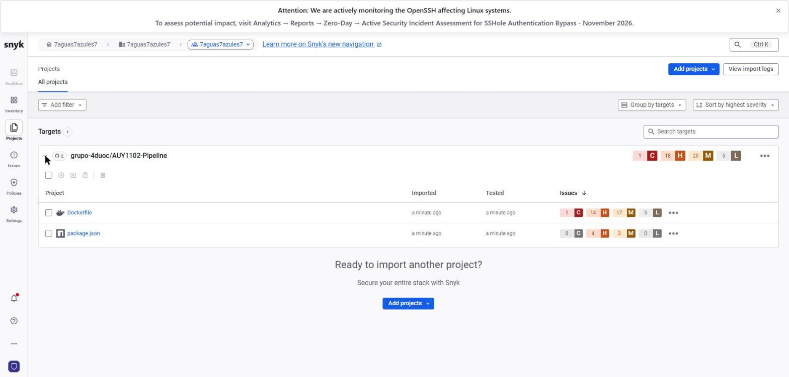

**Resultados del escaneo (estado inicial, antes de la remediación):**

| Proyecto Snyk | Críticas | Altas | Medias | Bajas |
|---|---:|---:|---:|---:|
| `Dockerfile` (imagen base) | 1 | 14 | 17 | 5 |
| `package.json` (dependencias npm) | 0 | 4 | 3 | 0 |
| **Total** | **1** | **18** | **20** | **5** |

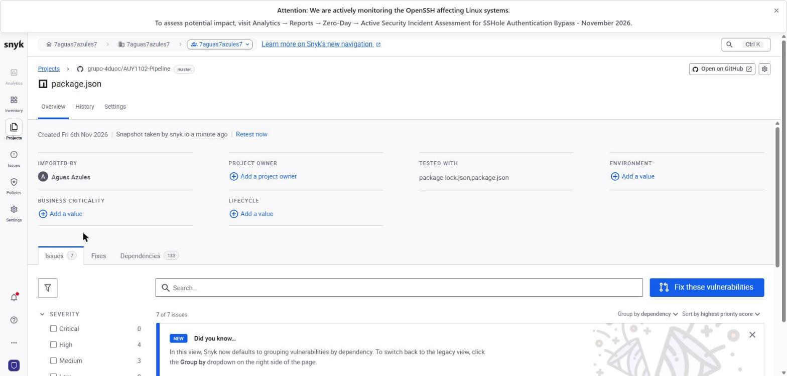

**Hallazgo principal en `package.json`:** `chokidar@2.0.3` arrastra 7 vulnerabilidades transitivas
(ReDoS en `decode-uri-component`, consumo excesivo de recursos y recursión no controlada en `braces`).
Snyk indica que **actualizar a `chokidar@3.0.0` corrige 6 de ellas** (cambio de versión mayor).

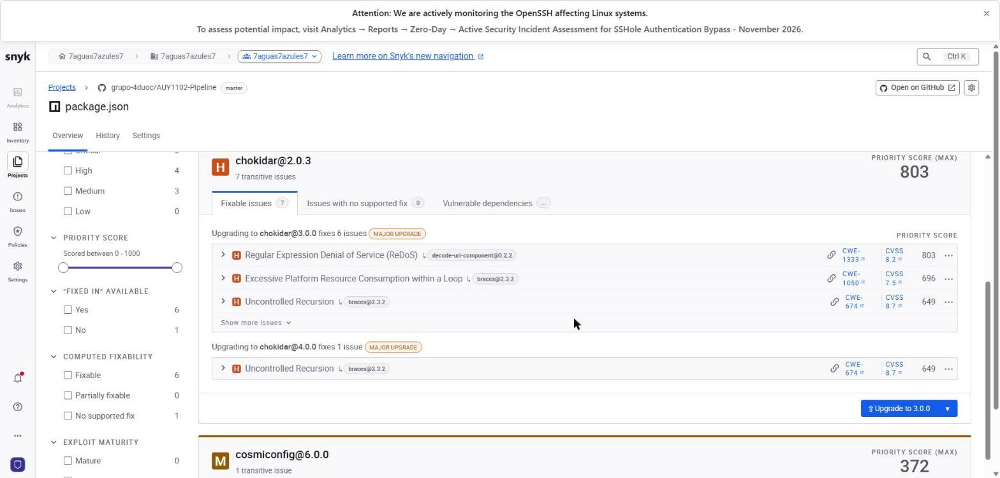

### 4.3 SonarCloud

**Qué es:** plataforma de análisis **estático** de código (SAST) que detecta *bugs*, vulnerabilidades,
*security hotspots*, *code smells* y duplicación, y además puede mostrar la cobertura de pruebas.

**Configuración en el repositorio:** se creó [`sonar-project.properties`](sonar-project.properties):

```properties
sonar.organization=grupo-4duoc
sonar.projectKey=grupo-4duoc_AUY1102-Pipeline
sonar.sources=src
sonar.tests=test
sonar.javascript.lcov.reportPaths=coverage/lcov.info
```

**Pasos realizados:**

1. Ingresar a https://sonarcloud.io con **GitHub**.
2. Verificar que la aplicación **SonarQube Cloud** esté instalada en la organización de GitHub `grupo-4duoc`
   (*Organization Settings → GitHub Apps*) con acceso al repositorio `AUY1102-Pipeline`.
3. En SonarCloud, ir a **+ → Analyze new project →** organización `grupo-4duoc`.
4. Marcar el repositorio **AUY1102-Pipeline** → **Set Up**. El proyecto se crea como público y
   SonarCloud ejecuta el primer análisis automáticamente (*Automatic Analysis*).

> **Incidencia y solución:** al principio SonarCloud respondía *"The request cannot be processed"*
> al listar los repositorios. La causa era que la cuenta usada no tenía rol **Admin** en la organización
> de SonarCloud. Al ingresar con la cuenta administradora, el repositorio apareció y se pudo importar.

**Resultados del análisis (rama `master`, código original, 792 líneas de código):**

| Métrica | Resultado |
|---|---|
| Quality Gate | *Not computed*: es el primer análisis y se calcula en el siguiente |
| Security | **16 problemas abiertos – nota E** |
| Reliability | 0 problemas – nota A |
| Maintainability | 1 problema – nota A |
| Duplicaciones | 0,0 % |
| Dependency risks | 125 – nota C |
| Coverage | No configurada (el análisis automático no importa cobertura; requiere análisis por CI con el reporte `coverage/lcov.info`) |

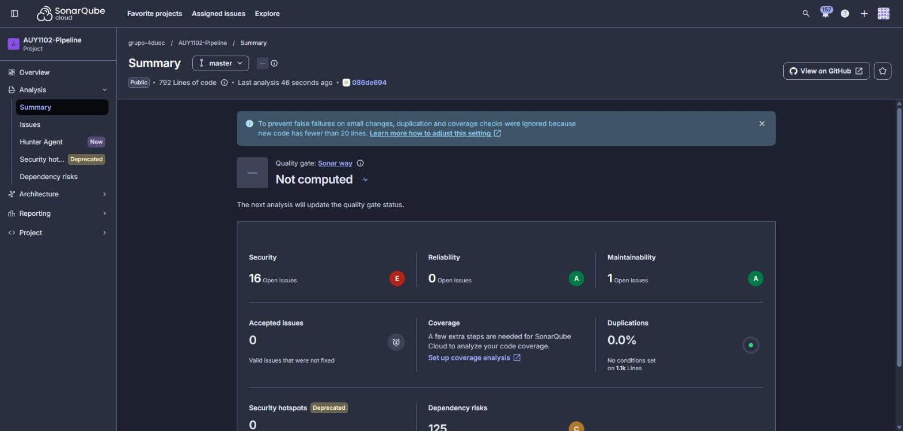

**Problemas de seguridad más importantes (severidad *Blocker*):**

| Archivo | Hallazgo de SonarCloud |
|---|---|
| `.npmrc` | Token de GitHub en el código: debe revocarse, cambiarse y eliminarse |
| `credentials.yml` | Token *hard-coded* (2 hallazgos) |
| `src/quality/insecure-1-object.ts` | *Server-Side Template Injection* (SSTI) por entrada de usuario sin sanitizar |

**Otros hallazgos:**
- **Dockerfile:** copia recursiva que podría incluir datos sensibles en la imagen (alta), y la imagen `node` se ejecuta como usuario `root` (baja).
- **Workflows de GitHub Actions:** `npm install` sin `--ignore-scripts` y dependencias sin versiones bloqueadas (media).
- **`insecure-1-object.ts`:** plantilla formateada dinámicamente (media) y Express revela su versión (baja).

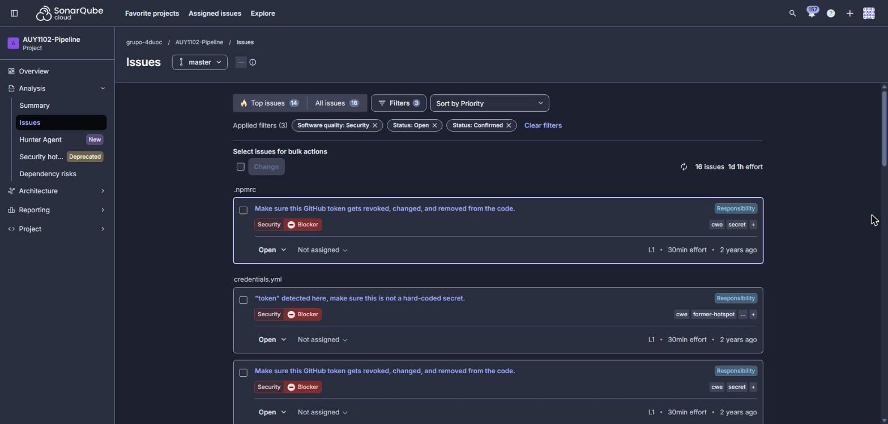

**Análisis:** SonarCloud confirmó los secretos expuestos y la vulnerabilidad SSTI que se habían
identificado en la revisión manual (sección 5). Además encontró riesgos que las herramientas de
dependencias (npm audit, Snyk y Dependabot) no ven, porque están en el **código y la configuración
propios** del proyecto: el Dockerfile y los workflows de GitHub Actions.

### 4.4 GitHub Advanced Security

**Qué es:** funciones de seguridad integradas en GitHub:
- **Dependency graph:** inventario de las dependencias del proyecto.
- **Dependabot alerts:** alertas cuando una dependencia tiene una vulnerabilidad conocida.
- **Secret scanning (Secret Protection):** detecta tokens y contraseñas subidos al repositorio.
- **Code scanning (CodeQL):** análisis estático. El repositorio ya incluye `.github/workflows/codeql.yml`.

> En repositorios **públicos** estas funciones son gratuitas.

**Estado inicial:** Dependabot alerts y Secret scanning estaban **desactivados**.

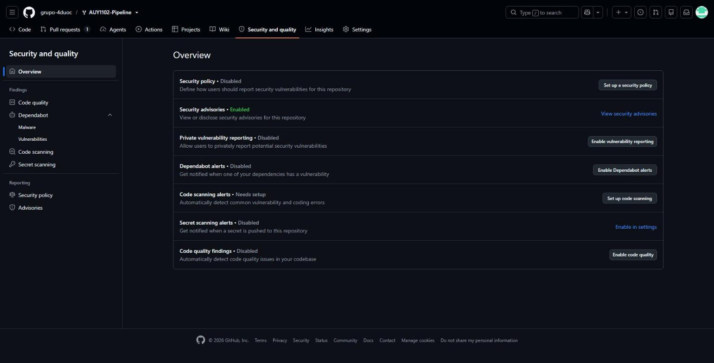

**Pasos realizados:**

1. Repositorio → **Settings → Advanced Security**.
2. **Dependency graph** → *On*.
3. **Dependabot alerts** → *On*.
4. **Secret Protection** → **Enable** → confirmar **Enable Secret Protection**.
5. No se activaron *Dependabot security updates* (PRs automáticos), porque la remediación se hace
   de forma manual, ni *Push protection*, para no bloquear el trabajo de la pareja.

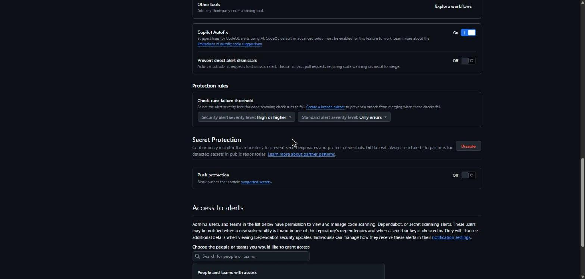

**Estado final:** Dependabot alerts y Secret scanning aparecen como **Enabled**.

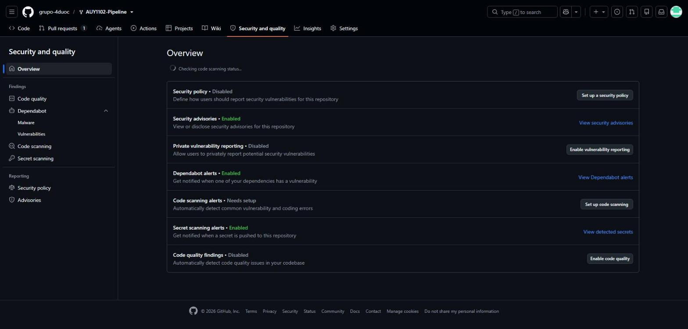

**Resultados:**

| Funcionalidad | Resultado |
|---|---|
| Dependabot alerts | **64 alertas abiertas**. Las más graves son 3 **críticas** de `handlebars` (inyección de JavaScript); le siguen altas de `flatted`, `tar` y `lodash`. |
| Secret scanning | **0 alertas.** GitHub solo alerta tokens con formato válido de proveedores conocidos; los secretos de este repo son de ejemplo o inactivos. SonarCloud sí los detectó (sección 4.3), lo que muestra que conviene usar varias herramientas. |

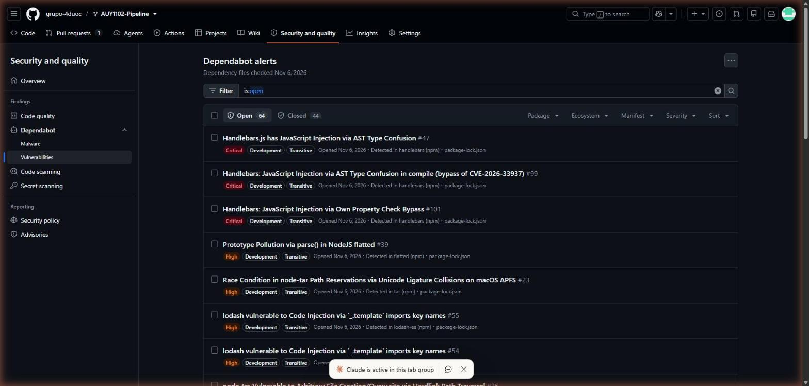

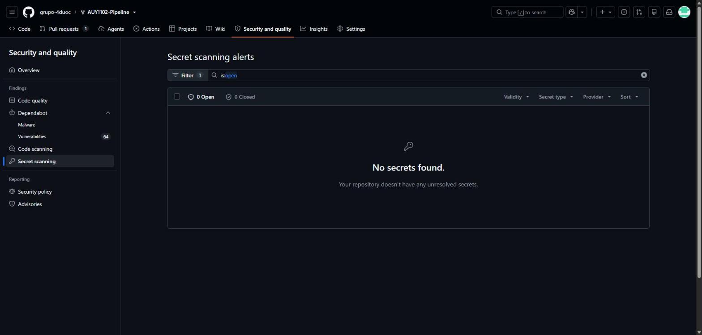

> **¿Por qué secret scanning no marcó los secretos de inmediato?** GitHub detecta con más prioridad
> los tokens con formato válido de proveedores conocidos. Los valores de ejemplo de `src/index.ts`
> (por ejemplo `ghp_1234567890abcdef...`) no son tokens reales, y el escaneo del historial puede tardar.
> Igual, los secretos sí fueron identificados en la revisión del código (sección 5).

### 4.5 Remediación

> Se debe aplicar **al menos una** remediación detectada por SonarCloud y/o Snyk.
> En este trabajo se aplicaron **dos**: una de Snyk (dependencias) y una de SonarCloud (secretos).

#### Remediación 1 – Actualización de `chokidar` (Snyk)

| Campo | Detalle |
|---|---|
| Herramienta que lo detectó | **Snyk** (*Snyk Open Source*), confirmado con `npm audit` y Dependabot |
| Problema | `chokidar@2.0.3` arrastra dependencias transitivas vulnerables: ReDoS en `decode-uri-component`, consumo descontrolado de recursos y recursión no controlada en `braces` (vía `micromatch`, `anymatch` y `readdirp`) |
| Archivo / dependencia | `package.json` → `dependencies.chokidar` (dependencia de **producción**) |
| Severidad | **Alta** (7 *issues* en Snyk, CVSS hasta 8.7) |
| Corrección aplicada | Actualización de `chokidar` de `^2.0.3` a `^3.6.0` (última versión 3.x) |
| Commit | `fix(deps): actualizar chokidar a 3.6.0` en la rama [`feature/parcial2-simon`](https://github.com/grupo-4duoc/AUY1102-Pipeline/commits/feature/parcial2-simon) |

##### Paso 1 – Análisis de impacto

Antes de actualizar se verificó si el código usa `chokidar`:

```bash
grep -r "chokidar" src test   # sin resultados
npm ls chokidar
```

```text
+-- @babel/cli@7.18.10
| `-- chokidar@3.6.0
+-- chokidar@2.0.3          <- dependencia directa vulnerable
`-- ts-node-dev@2.0.0
  `-- chokidar@3.6.0
```

**Conclusión:** `chokidar` **no se importa en ningún archivo** de `src/` ni `test/`; solo está declarado en
`package.json`. Además, la versión `3.6.0` ya estaba en el proyecto (la usan `@babel/cli` y `ts-node-dev`).
Por eso el cambio de versión mayor (2 → 3) tiene **bajo riesgo**.

##### Paso 2 – Evidencia "antes"

```bash
npm audit --omit=dev > docs/npm-audit-prod-ANTES.txt
```

```text
braces  <3.0.3                       Severity: high
  chokidar  1.3.0 - 2.1.8            (depende de anymatch y braces vulnerables)
  micromatch  <=4.0.7                (depende de braces vulnerable)
    anymatch  1.2.0 - 2.0.0
    readdirp  2.2.0 - 2.2.1
decode-uri-component  <=0.5.0        Severity: high
  source-map-resolve  >=0.5.1
yaml  1.0.0 - 1.10.2                 Severity: moderate

8 vulnerabilities (3 moderate, 5 high)
```

Reporte completo: [`docs/npm-audit-prod-ANTES.txt`](docs/npm-audit-prod-ANTES.txt)

##### Paso 3 – Corrección

```bash
npm install chokidar@^3.6.0
npm ls chokidar
```

```text
+-- @babel/cli@7.18.10
| `-- chokidar@3.6.0 deduped
+-- chokidar@3.6.0
`-- ts-node-dev@2.0.0
  `-- chokidar@3.6.0 deduped
```

- `package.json`: `"chokidar": "^2.0.3"` → `"chokidar": "^3.6.0"`.
- `package-lock.json`: se **eliminaron 134 paquetes** obsoletos que solo existían por `chokidar@2`
  (`micromatch@3`, `braces@2`, `snapdragon`, `decode-uri-component`, etc.) y **no se agregó ninguno**.
  Esto reduce la superficie de ataque del proyecto.

##### Paso 4 – Prueba de regresión

```bash
npm run test:coverage
```

```text
==================== 2. PRUEBAS QUE FALLAN ====================
Suites : 10 OK / 0 con fallos / 10 total
Pruebas: 18 OK / 0 fallidas / 18 total

✔ Todas las pruebas pasaron.
...
  Líneas      :  43.28 %  (29/67)
  Resultado    : ÉXITO ✔
```

Las **18 pruebas siguen pasando** y la cobertura no cambió: la actualización no introdujo regresiones.
(Esta remediación se hizo **antes** de integrar las pruebas de Abraham; con todo integrado pasan
23 de 23 pruebas, ver sección 3.6).

##### Paso 5 – Evidencia "después"

```bash
npm audit --omit=dev > docs/npm-audit-prod-DESPUES.txt
```

```text
picomatch  <=2.3.1                   Severity: high
  fix available via `npm audit fix`
yaml  1.0.0 - 1.10.2                 Severity: moderate
  fix available via `npm audit fix`

2 vulnerabilities (1 moderate, 1 high)
```

Reporte completo: [`docs/npm-audit-prod-DESPUES.txt`](docs/npm-audit-prod-DESPUES.txt)

##### Resultado

| Severidad (producción) | Antes | Después |
|---|---:|---:|
| Alta | 5 | 1 |
| Moderada | 3 | 1 |
| **Total** | **8** | **2** |

| Vulnerabilidad | Antes | Después |
|---|---|---|
| `braces` (alta) | ❌ Presente | ✅ Corregida |
| `micromatch` (alta) | ❌ Presente | ✅ Corregida |
| `anymatch` (alta) | ❌ Presente | ✅ Corregida |
| `readdirp` (alta) | ❌ Presente | ✅ Corregida |
| `decode-uri-component` (alta) | ❌ Presente | ✅ Corregida |
| `chokidar` (moderada) | ❌ Presente | ✅ Corregida |
| `source-map-resolve` (moderada) | ❌ Presente | ✅ Corregida |
| `picomatch` (alta) | – | ⚠️ **Nueva** |
| `yaml` (moderada) | ❌ Presente | ❌ Pendiente |

**Análisis del resultado:**
- Se corrigieron **7 de las 8** vulnerabilidades de producción originales.
- **`picomatch@2.3.1` (nueva):** `chokidar@3` reemplazó a `micromatch`/`braces` por `picomatch`, y esa
  versión tiene un aviso de *ReDoS* y *method injection*. Esto demuestra por qué **siempre hay que volver
  a escanear después de una actualización**: corregir una dependencia puede introducir otra. Se corrige
  con `npm audit fix` (sin cambios incompatibles).
- **`yaml` (pendiente):** **no estaba relacionada con chokidar**. Viene de `cosmiconfig@6` y también
  se corrige con `npm audit fix`.

#### Remediación 2 – Eliminación de `credentials.yml` (SonarCloud)

| Campo | Detalle |
|---|---|
| Herramienta que lo detectó | **SonarCloud** (ver sección 4.3) |
| Problema | Credenciales escritas directamente en un archivo versionado (*hard-coded secret*, 2 hallazgos) |
| Archivo | `credentials.yml` (raíz del repositorio) |
| Severidad | **Blocker** (la máxima en SonarCloud) |
| Corrección aplicada | Eliminación del archivo del repositorio con `git rm` |
| Commit | `fix(security): eliminar credentials.yml` en la rama [`feature/parcial2-simon`](https://github.com/grupo-4duoc/AUY1102-Pipeline/commits/feature/parcial2-simon) |

**Pasos realizados:**

1. Verificar que ningún archivo del proyecto (código, pruebas, workflows o configuración) usa
   `credentials.yml`, para que eliminarlo no rompa nada:
   ```bash
   grep -r "credentials" --exclude-dir=node_modules .   # sin referencias
   ```
2. Eliminar el archivo y registrar la eliminación en Git:
   ```bash
   git rm credentials.yml
   git commit -m "fix(security): eliminar credentials.yml"
   ```

**Limitación importante, el historial de Git:** `git rm` borra el archivo **desde este commit en
adelante**, pero el contenido **sigue existiendo en los commits anteriores**. Cualquiera puede verlo
navegando el historial del repositorio o con `git log -p -- credentials.yml`. Por eso, en un caso real:

1. **Revocar o rotar** inmediatamente las credenciales expuestas. Es el paso más importante: hay
   que asumir que el secreto ya está comprometido.
2. Opcionalmente, limpiar el historial con herramientas como `git filter-repo` o *BFG Repo-Cleaner*
   (reescribe todos los commits y requiere coordinar al equipo).
3. Guardar los secretos en un lugar seguro, como **GitHub Secrets** o un gestor de secretos, y activar
   **Push protection** para bloquear futuros intentos de subir credenciales.

**Otras remediaciones posibles (no aplicadas):**
- **Secretos en `src/index.ts`:** eliminar `apiKey` y `githubToken` escritos en el código, leerlos
  desde variables de entorno (`process.env`) y quitar la llamada automática a `fetchData()`.
- **Token en `.npmrc`:** revocar el token y reemplazarlo por `${NPM_TOKEN}`.
- **`picomatch` y `yaml`:** ejecutar `npm audit fix` para cerrar las 2 vulnerabilidades de producción restantes.

### 4.6 Integración a `master` y verificación de las remediaciones

**1. Pull Request y merge.** El trabajo se integró a la rama principal con el **Pull Request #5**
(`feature/parcial2-simon` → `master`). Ese PR incluye el commit de Abraham Ravelo de la rama
`feature/pruebas-unitarias`, así que su **PR #4 también quedó como *Merged***. No hubo conflictos con `master`.

> En el PR fallaron **3 de 5 *checks***: `test` y `lint`, que vienen del workflow original
> `pull_request.yml` (usa Node 14 y `actions/*@v2`, versiones obsoletas; ver hallazgo 5.7), y
> `SonarCloud Code Analysis`, que corresponde al *Quality Gate* de SonarCloud sobre el código del PR.
> Los análisis de **CodeQL** pasaron. Los *checks* fallidos no impidieron el merge.

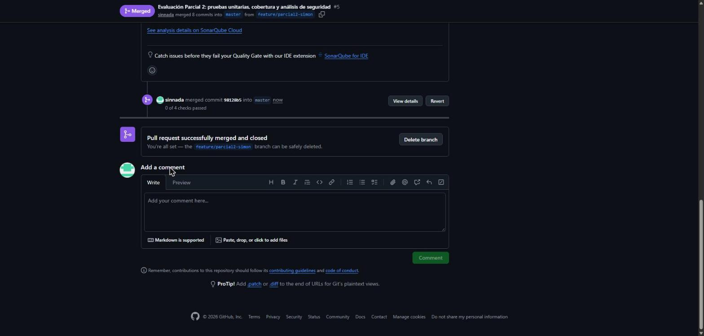

**2. SonarCloud volvió a analizar `master` automáticamente:**

| Métrica | Antes | Después |
|---|---|---|
| Quality Gate | *Not computed* | **Passed** ✔ |
| Hallazgos *Blocker* de `credentials.yml` | 2 abiertos | **2 *Fixed*** ✔ |
| Dependency risks | 125 | 120 |

Los dos hallazgos de `credentials.yml` aparecen con estado **Fixed**. Esto confirma la
**Remediación 2**, que fue detectada por SonarCloud.

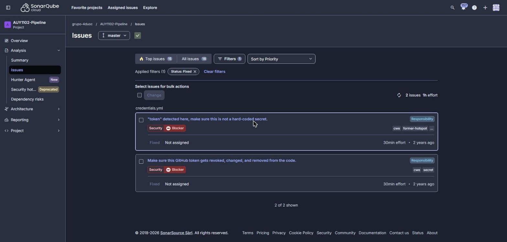

**3. Snyk: nuevo escaneo (*Retest now*) de `package.json` en `master`:**

| | Antes | Después |
|---|---:|---:|
| Vulnerabilidades (issues) | 7 | **4** |
| Altas | 4 | **2** |
| Medias | 3 | 2 |
| Dependencias analizadas | 133 | **40** |

La actualización de `chokidar` a 3.6.0 (**Remediación 1**, detectada por Snyk) eliminó las
vulnerabilidades de `chokidar@2.0.3` y sacó del proyecto 93 dependencias obsoletas. Las 4 que quedan
vienen de dependencias transitivas de `chokidar@3.6.0` (3 *issues*, por ejemplo `picomatch`) y de
`cosmiconfig` (`yaml`). Snyk marca solo 1 de las de `chokidar` como corregible y 2 **sin corrección
disponible por ahora**. `npm audit fix` puede resolver parte de ellas (`picomatch`, `yaml`) en una
siguiente iteración.

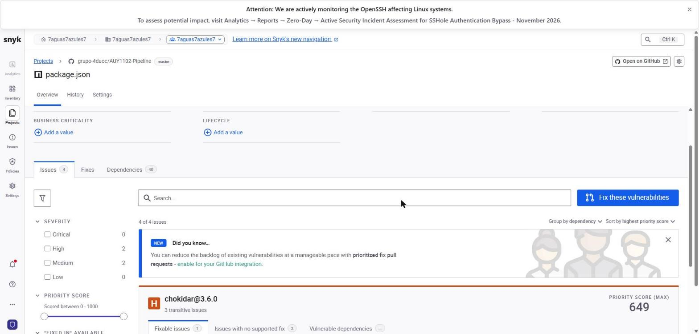

---

## 5. Hallazgos de seguridad detectados en el código

| # | Archivo | Hallazgo | Riesgo |
|---|---|---|---|
| 5.1 | `src/index.ts` | `apiKey` y `githubToken` escritos en el código. La API key viaja en la URL y `fetch` se ejecuta al importar el módulo. | Exposición de credenciales y efecto secundario no controlado. |
| 5.2 | `.npmrc` | Contiene un token de GitHub (`ghp_...`) en texto plano dentro del repositorio. | Cualquiera con acceso al repo podría usarlo. Debe revocarse y reemplazarse por `${NPM_TOKEN}`. |
| 5.3 | `credentials.yml` | Archivo con credenciales versionado. | Exposición de credenciales. **Remediado:** archivo eliminado (ver 4.5, Remediación 2); sigue en el historial de Git. |
| 5.4 | `src/quality/insecure-1-object.ts` | La entrada del usuario se inserta en una plantilla **Pug** antes de compilarla. | *Server-Side Template Injection* (SSTI) → ejecución remota de código y XSS. |
| 5.5 | `src/quality/insecure-2-object.ts` | SQL armado concatenando texto, HTML sin escapar, endpoint sin token CSRF, contraseñas en el código y en los logs. | SQL Injection, XSS, CSRF y exposición de credenciales. |
| 5.6 | `src/quality/errores-object.ts` | Variables sin usar, tipo incorrecto (`string = 10`) y métodos vacíos. | Calidad y mantenibilidad (*code smells*). |
| 5.7 | `.github/workflows/pull_request.yml` | Usa Node 14 (sin soporte) y `actions/*@v2` (obsoletas). | Pipeline con componentes sin parches de seguridad. |

---

## 6. Conclusiones

- Las **pruebas unitarias** detectan errores temprano y evitan regresiones. Con el 43 % de cobertura
  inicial, un bug que dejaba inutilizable `DateValueObject` pasaba desapercibido. Al escribir pruebas
  para esa clase, el bug apareció, se corrigió y la cobertura subió a **64 %**.
- **npm audit, Snyk y Dependabot** atacan el mismo problema (dependencias vulnerables) desde distintos
  puntos del ciclo de vida: en el equipo local, en una plataforma de seguridad y directamente en GitHub.
  Los tres coincidieron en hallazgos como `handlebars`, `tar`, `lodash` y `chokidar`.
- **SonarCloud y CodeQL** (análisis estático) detectan vulnerabilidades en el **código propio**, como
  SQL injection, SSTI o credenciales, antes de que lleguen a producción.
- **Secret scanning** previene uno de los incidentes más comunes: subir contraseñas o tokens al repositorio.
- Integrar estas herramientas en cada *Pull Request* convierte la calidad y la seguridad en un proceso
  **automático y continuo** (*DevSecOps*), en lugar de una revisión manual al final.

**Conclusión personal:** con este trabajo nos dimos cuenta de que tener las pruebas en verde no significa
que el proyecto esté bien: con 18 pruebas pasando igual teníamos menos de la mitad del código cubierto,
un bug escondido en `DateValueObject`, secretos expuestos y dependencias vulnerables. También aprendimos que ninguna herramienta lo ve todo
(Secret scanning no marcó los tokens, pero SonarCloud sí) y que después de cada corrección hay que volver
a escanear y a correr las pruebas, porque arreglar una cosa puede traer otro problema, como nos pasó con `picomatch`.

---

## 7. Distribución del trabajo

| Integrante | Rama | Actividades realizadas |
|---|---|---|
| **Abraham Ravelo** | `feature/pruebas-unitarias` (PR #4) | • Detectó y corrigió el bug de la condición invertida en `DateValueObject` (sección 3.4).<br>• Creó el *mock* `BirthDate` y las 5 pruebas unitarias de `DateValueObject`, que subieron su cobertura de 6,66 % a 100 %.<br>• Creó el script `scripts/reporte-pruebas.js` y el comando `npm run test:report` (sección 3.5).<br>• Redactó los conceptos clave (IE3.1.1) y la tabla de herramientas (IE3.2.1) de las secciones 1.1 y 1.2. |
| **Simón Lagos** | `feature/parcial2-simon` | • Preparó el entorno (Node.js) y la rama de trabajo.<br>• Creó el script `scripts/run-tests.sh` y el comando `npm run test:coverage` (sección 3.2).<br>• Ejecutó `npm audit` y guardó los reportes en `docs/` (sección 4.1).<br>• Conectó y analizó el repositorio en Snyk (4.2) y SonarCloud, con `sonar-project.properties` (4.3), y activó GitHub Advanced Security (4.4).<br>• Aplicó la Remediación 1 (`chokidar` 3.6.0, detectada por Snyk) y la Remediación 2 (eliminación de `credentials.yml`, detectada por SonarCloud) (4.5).<br>• Integró la rama de Abraham con `git merge`, resolvió el conflicto de `package.json` y unificó la documentación en este archivo. |

**Integración:** como Abraham no estaba disponible al momento de unir el trabajo, su rama
(`feature/pruebas-unitarias`, PR #4) se integró en `feature/parcial2-simon` mediante `git merge`. Su
commit conserva su autoría en el historial de Git (`git log --format='%an %s'`).

---

### Anexo – Archivos creados o modificados en la rama `feature/parcial2-simon`

| Archivo | Cambio |
|---|---|
| `src/value-object/primitives/date-value-object.ts` | *(Abraham)* Corrección del bug de validación de fechas |
| `test/value-object/primitives/DateValueObject/*` | *(Abraham)* Nuevo: mock `BirthDate` y 5 pruebas unitarias |
| `scripts/reporte-pruebas.js` | *(Abraham)* Nuevo: script de reporte de cobertura (`npm run test:report`) |
| `scripts/run-tests.sh` | Nuevo: script de pruebas, cobertura, fallos y código no cubierto |
| `package.json` | `test:coverage` ejecuta `bash scripts/run-tests.sh`; `test:report` *(Abraham)*; `chokidar` actualizado a `^3.6.0` |
| `package-lock.json` | Remediación: `chokidar@3.6.0` y eliminación de 134 paquetes obsoletos |
| `docs/npm-audit-prod-ANTES.txt` / `-DESPUES.txt` | Evidencia de la remediación (npm audit de producción) |
| `credentials.yml` | **Eliminado**: remediación del hallazgo *Blocker* de SonarCloud |
| `.gitignore` | Se agrega `coverage` |
| `sonar-project.properties` | Nuevo: configuración de SonarCloud |
| `docs/npm-audit-report.txt` / `.json` | Nuevo: reporte completo de npm audit |
| `docs/npm-audit-prod-report.txt` | Nuevo: reporte de npm audit solo de producción |
| `img/*.jpg` | Capturas de evidencia |
| `DOCUMENTACION.md` | Nuevo: este documento (incluye el contenido del `INFORME.md` de Abraham) |
| `INFORME.md` | *(Abraham)* Integrado en este documento y luego eliminado, para dejar un solo documento |
